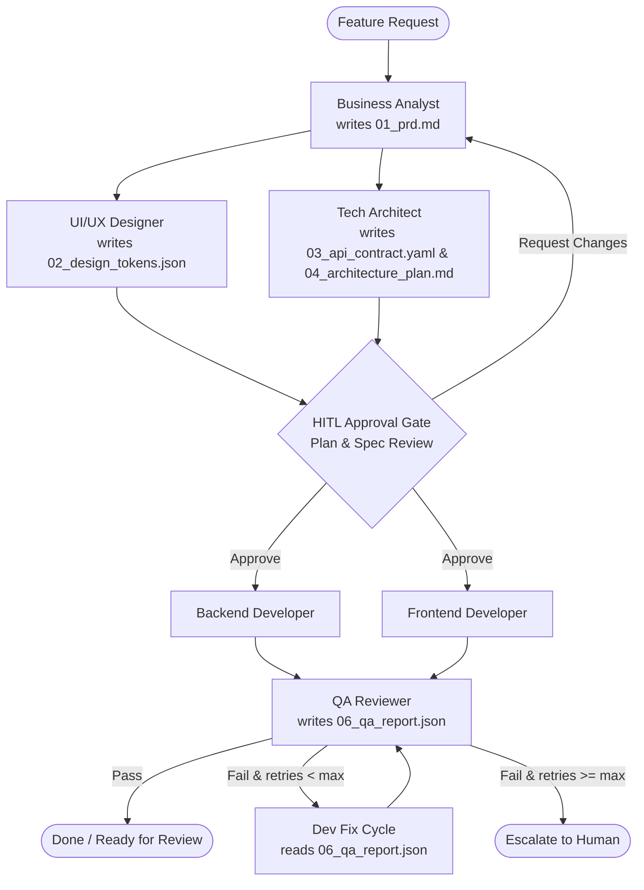

# CrewForge Architecture Blueprint

> **CrewForge** is a modular, production-grade **Multi-Agent Software Development Orchestrator** built with Python 3.12+ and LangGraph. It attaches a configurable virtual engineering team to any target project directory (`workspace`) to plan, design, implement, and verify software features through structured file artifacts and Human-in-the-Loop (HITL) approval gates.

---

## 1. Core Architectural Principles

1. **Stateful Graph Orchestration (LangGraph)**
   - Uses `StateGraph` with persistent checkpointing (`SqliteSaver` for real runs, `MemorySaver` for ephemeral/test runs).
   - Supports **Human-in-the-Loop (HITL)** approval gates via `interrupt()` / `Command(resume=...)` so humans review specifications before code generation begins.
   - Enforces bounded **QA feedback loops** (`dev -> qa -> fix`) with a configurable `max_qa_retries` guard to prevent infinite cycles.

2. **Artifact-Driven Memory (`.ai-team/`)**
   - Agents do **not** pass giant conversational histories between roles, avoiding token bloat and context drift.
   - Each role reads specific upstream artifacts and writes its own structured output (Markdown, JSON, YAML) into `<workspace>/.ai-team/`.
   - A `manifest.json` file tracks artifact paths, producing agent, revision number, SHA-256 hash, and timestamps.

3. **Config-Driven Personas & Local-First Models**
   - Agent roles, system prompts, tool allowlists, and artifact contracts are defined in `config/agents.yaml`.
   - LLM profiles live in `config/models.yaml` with free local **Ollama** models as the default, while allowing one-line swaps to OpenAI or Anthropic.
   - Workflow settings (HITL gate toggles, retry limits, checkpointer backend) live in `config/workflow.yaml`.
   - Target workspaces can override default configs locally via `<workspace>/.ai-team/config/`.

4. **Workspace-Scoped Tooling & MCP Readiness**
   - Every filesystem, shell, and git tool is strictly sandboxed to the target `workspace` root (path-traversal and symlink-escape protection).
   - Tools implement a clean protocol with an adapter seam (`src/crewforge/tools/mcp_adapter.py`) so external **Model Context Protocol (MCP)** servers can be mounted without altering agent or graph logic.

5. **Decoupled Engine for CLI & Future Web UI**
   - Core orchestration lives in `crewforge.engine` and `crewforge.graph`, emitting typed lifecycle events.
   - `crewforge.cli` is a thin `typer` + `rich` presentation wrapper, allowing a future FastAPI + Next.js Kanban dashboard to drive the exact same engine.

---

## 2. High-Level Workflow Graph



---

## 3. Target Workspace Artifact Contract (`.ai-team/`)

When CrewForge attaches to any target repository (`--workspace /path/to/repo`), it manages shared agent memory inside `.ai-team/`:

```text
<target-workspace>/
└── .ai-team/
    ├── manifest.json              # Artifact registry, versions, SHA-256 hashes, run metadata
    ├── checkpoints.sqlite         # LangGraph persistent checkpoint DB (configurable)
    ├── 01_prd.md                  # Business Analyst: user stories & acceptance criteria
    ├── 02_design_tokens.json      # UI/UX Designer: design tokens, layout & UI states
    ├── 03_api_contract.yaml       # Tech Architect: OpenAPI / module interface contracts
    ├── 04_architecture_plan.md    # Tech Architect: file-level implementation blueprint
    ├── 05_implementation_log.md   # Backend & Frontend Devs: changed files & decisions
    └── 06_qa_report.json          # QA Reviewer: structured pass/fail verdict & findings
```

---

## 4. Package Module Responsibilities

| Module             | Responsibility                                                                                           |
| :----------------- | :------------------------------------------------------------------------------------------------------- |
| `crewforge.config` | Pydantic v2 schemas and YAML loader with env-var interpolation and workspace overrides.                  |
| `crewforge.state`  | LangGraph `ProjectState` (`TypedDict`), state reducers, and artifact/QA/HITL domain models.              |
| `crewforge.llm`    | Provider-agnostic `BaseChatModel` factory (Ollama default, OpenAI/Anthropic optional, Fake for tests).   |
| `crewforge.tools`  | Path-jailed workspace filesystem, shell/linter, and git tools + MCP adapter seam.                        |
| `crewforge.agents` | Agent factory that hydrates YAML personas, injects targeted artifacts, and binds allowed tools.          |
| `crewforge.graph`  | `StateGraph` builder, node wrappers, conditional routing (HITL + QA retry loop), and checkpointer setup. |
| `crewforge.engine` | High-level `OrchestratorRunner` facade and typed lifecycle events (shared by CLI and future API).        |
| `crewforge.cli`    | Thin `typer` + `rich` CLI (`run`, `resume`, `status`, `init`) consuming `crewforge.engine`.              |

---

## 5. Security & Testing Boundaries

### Security

- **Path Jail:** Every file operation resolves paths against `workspace_root.resolve()` and rejects traversal (`..`) or symlink escapes outside the workspace.
- **Scoped Shell Execution:** Commands run with `cwd=workspace_root`, explicit timeouts, and configurable allowlists.
- **No Hardcoded Secrets:** YAML configs only store environment variable references (`${VAR}` or `${VAR:-default}`).

### Testing

- **100% Offline CI:** All unit and integration tests run deterministically using fake/mocked LLMs and `pytest`'s `tmp_path` fixture—no local Ollama server or cloud API keys required.

---

## 6. Iterative Build Roadmap

- **Step 1:** Repository layout, `pyproject.toml`, `ARCHITECTURE.md`, and `GEMINI.md`.
- **Step 2:** Default YAML configs (`models.yaml`, `agents.yaml`, `workflow.yaml`), Pydantic schemas, `ProjectState`, and YAML config loader.
- **Step 3:** Provider-agnostic LLM factory, Agent factory, and workspace-sandboxed artifact/file tools + MCP adapter seam.
- **Step 4:** LangGraph `StateGraph` (`BA -> Designer/Architect -> HITL Gate -> Dev -> QA Loop`) with SQLite checkpointing.
- **Step 5:** Thin CLI (`typer` + `rich`) and unit/integration test suite with mocked LLMs.
