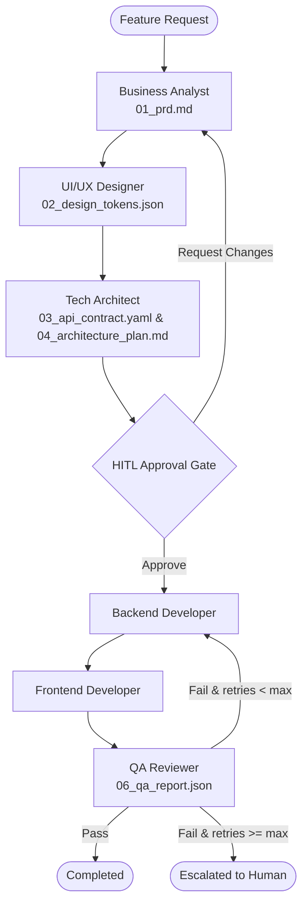

# CrewForge

[](https://www.python.org/downloads/)
[](https://github.com/langchain-ai/langgraph)
[](https://docs.astral.sh/uv/)
[](https://github.com/astral-sh/ruff)
[](https://mypy-lang.org/)
[](./LICENSE)

**CrewForge** is a modular, production-grade **Multi-Agent Software Development Orchestrator** built with **Python 3.12+** and **LangGraph**.

Attach a configurable virtual engineering team (**Business Analyst**, **UI/UX Designer**, **Tech Architect**, **Backend Developer**, **Frontend Developer**, and **QA Reviewer**) to any target project directory (`workspace`) to plan, design, implement, and verify software features through structured file artifacts and Human-in-the-Loop (HITL) approval gates.

---

## Key Architectural Highlights

- **Stateful Graph Orchestration (LangGraph):** Persistent SQLite checkpointing (`SqliteSaver`) with native `interrupt()` / `Command(resume=...)` Human-in-the-Loop gates and bounded QA fix loops (`max_qa_retries`).
- **Artifact-Driven Memory (`.ai-team/`):** Agents exchange compact, versioned files (`01_prd.md`, `02_design_tokens.json`, `03_api_contract.yaml`, `06_qa_report.json`) tracked by SHA-256 hashes in `manifest.json` instead of bloated chat transcripts.
- **Local-First & Provider-Agnostic:** Ships with free local **Ollama** model defaults (`qwen2.5:7b` and `qwen2.5-coder:7b`) configured in YAML, with one-line swaps to OpenAI or Anthropic and per-workspace config overrides.
- **Workspace-Sandboxed Tools & MCP Ready:** Strict path-jail filesystem, allowlisted shell, and read-only git tools implementing a `ToolProvider` protocol with an adapter seam for **Model Context Protocol (MCP)** servers.
- **Decoupled Engine for CLI & Future Web UI:** Core orchestration lives in `crewforge.engine.OrchestratorRunner` and returns Pydantic `RunOutcome` models—driven by a thin `typer` + `rich` CLI today and ready for a FastAPI + Next.js Kanban dashboard tomorrow.

---

## Workflow Architecture



See [ARCHITECTURE.md](./ARCHITECTURE.md) for the complete system design and module map.

---

## Quickstart

### 1. Prerequisites

- **Python 3.12+**
- **[uv](https://docs.astral.sh/uv/)** (package manager)
- **[Ollama](https://ollama.com)** (for free local models)

Pull the default local models:

```bash
ollama pull qwen2.5:7b
ollama pull qwen2.5-coder:7b
```

### 2. Install CrewForge

```bash
git clone https://github.com/diogocorreia01/crewforge.git
cd crewforge
uv sync
```

Verify your configuration and virtual team mapping:

```bash
uv run crewforge doctor
```

### 3. Run Against Any Target Workspace

Initialize `.ai-team/` and start a feature workflow:

```bash
uv run crewforge init --workspace /path/to/your-project
uv run crewforge run "Add a /health endpoint returning app version and uptime" --workspace /path/to/your-project
```

Execution pauses at the **HITL Approval Gate** after planning completes. Review the generated specs inside `/path/to/your-project/.ai-team/`, then either approve or request changes:

```bash
# Approve and proceed to implementation + QA
uv run crewforge resume <run-id> --workspace /path/to/your-project --approve

# Or request revisions (loops back to the Business Analyst with your notes)
uv run crewforge resume <run-id> --workspace /path/to/your-project --reject --feedback "Rename uptime to uptime_seconds"

# Inspect saved checkpoint status at any time
uv run crewforge status <run-id> --workspace /path/to/your-project
```

---

## Target Workspace Artifact Contract (`.ai-team/`)

| Artifact                   | Producer                | Purpose                                                  |
| :------------------------- | :---------------------- | :------------------------------------------------------- |
| `manifest.json`            | Orchestrator            | Tracks artifact revisions, producers, and SHA-256 hashes |
| `checkpoints.sqlite`       | LangGraph               | Persistent SQLite checkpoint store for HITL pause/resume |
| `01_prd.md`                | Business Analyst        | User stories, scope boundaries, and acceptance criteria  |
| `02_design_tokens.json`    | UI/UX Designer          | Design tokens, component hierarchy, and UI states        |
| `03_api_contract.yaml`     | Tech Architect          | OpenAPI / module interface contracts                     |
| `04_architecture_plan.md`  | Tech Architect          | File-level implementation blueprint and test strategy    |
| `05_implementation_log.md` | Backend & Frontend Devs | Summary of created/modified files and verification notes |
| `06_qa_report.json`        | QA Reviewer             | Strictly validated JSON pass/fail verdict and issue list |

---

## Configuration & Model Swapping

CrewForge is 100% config-driven via three YAML files in `config/`:

- `config/models.yaml` — Named LLM profiles (`ollama`, `openai`, `anthropic`) with `${VAR:-default}` env-var interpolation.
- `config/agents.yaml` — Role prompts, artifact read/write contracts, and least-privilege `allowed_tools`.
- `config/workflow.yaml` — HITL gate toggle, `max_qa_retries`, parallel planning toggle, and checkpointer backend.

To override any setting for a specific target repository without modifying CrewForge itself, place partial YAML files inside `<target-workspace>/.ai-team/config/`—they are deep-merged automatically at load time.

To use optional cloud providers:

```bash
uv add langchain-openai      # or langchain-anthropic
```

---

## Development & Testing

All unit and integration tests run **100% offline** using mocked LLMs and temporary workspaces (`tmp_path`):

```bash
# Lint
uv run ruff check .

# Strict static type checking
uv run mypy src tests

# Unit + end-to-end LangGraph integration tests
uv run pytest -v
```

---

## Roadmap

- [ ] FastAPI + WebSocket server exposing `OrchestratorRunner`
- [ ] Next.js Kanban dashboard for visual HITL review and live agent telemetry
- [ ] Live MCP server integration via `MCPToolAdapter` (GitHub, Jira, Postgres)
- [ ] Isolated git worktree branching per feature run

---

## License

MIT License — see [LICENSE](./LICENSE) for details.
